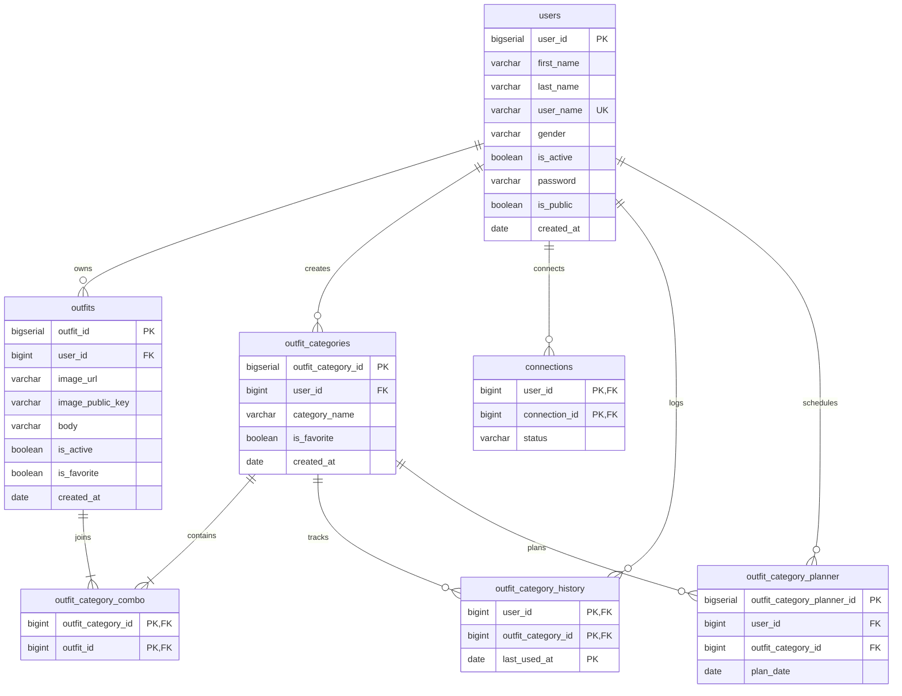

# LookLoom 🪡✨
### The Digital Wardrobe Studio & Intelligent Outfit Rotation Engine

LookLoom is a production-grade digital wardrobe management application engineered to help curators catalog garments, assemble cohesive looks, rotate outfits intelligently, and plan fashion ensembles on an interactive calendar.

Built with a modern stack featuring **React 19**, **Vite 7**, **Tailwind CSS v4**, **Redux Toolkit**, **Express 5**, **PostgreSQL**, and **Cloudinary**, LookLoom delivers an aesthetic inspired by Apple's Human Interface Guidelines—combining subtle pastel accents, high-contrast action triggers, fluid animations, and a persistent dual-theme engine.

---

## 🌟 Key Features

### 🗄️ Wardrobe Cataloging & Laundry Tracking
- **High-Resolution Cloud Ingestion**: Upload garments directly to Cloudinary with automatic optimization.
- **Wearable / Laundry Toggle**: Track wearable garments versus pieces currently in the wash with instant status pills.
- **Garment Notes & Search**: Filter and search through wardrobe pieces with real-time **350ms debouncing** to minimize render thrashing.
- **Favorite & Archive Collections**: Pin signature pieces to your favorites for instant access.

### 🎨 Curated Ensembles & Capsule Wardrobes
- **Category Composition**: Group multiple wardrobe pieces into composite looks (e.g., *Nordic Casual*, *Gallery Night*, *Summer Linen*).
- **Relational Matrix**: Many-to-many combo model allowing a single garment to belong to multiple curated categories.
- **Dynamic Bento Grids**: Visual representation of all category pieces with lazy-loaded imagery and quick edit controls.

### 🗓️ Daily Rotation & Event Planning
- **Today's Active Look**: Single-click assignment of your daily ensemble with visual active badges.
- **Calendar Event Scheduling**: Plan future outfits for dates, events, or travel capsules.
- **Outfit History & Wear Logs**: Keep an audit trail of when each look was last worn to prevent style repetition.

### 👥 Curator Social Network & Privacy
- **Curator Directory**: Discover fellow stylists with real-time user handle search.
- **Public & Private Profiles**: Granular privacy controls allowing users to keep wardrobes private or share their style archive.
- **Follow Requests & Activity**: Manage connections, view mutual followers, and inspect shared looks.

### 🌓 Apple HIG Design System & Dual-Theme Engine
- **Harmonious Pastel Accents**: Balanced pastel washes (Lavender `#8b5cf6`, Rose `#f43f5e`, Mint `#10b981`, Sky `#0ea5e9`, Apricot `#f59e0b`) paired with high-contrast electric focal CTAs.
- **Seamless Light/Dark Themes**: Fully reactive theme toggle with `localStorage` persistence and pre-hydration flash prevention.
- **Responsive Layout**: Designed mobile-first with adaptive drawers, bento grids, and fluid motion transitions powered by Framer Motion.

---

## 🏗️ Architecture & Tech Stack

```
LookLoom Repository
├── CLIENT/                     # React 19 Frontend (Vite 7 + Tailwind CSS v4)
│   ├── src/
│   │   ├── components/         # Reusable UI primitives (Navbar, Footer, Snackbar, Motion)
│   │   ├── context/            # Global ThemeContext engine
│   │   ├── hooks/              # useDebounce and custom React hooks
│   │   ├── pages/              # 11 dynamic & authenticated application views
│   │   ├── redux/              # Redux Toolkit store, 7 domain slices & async thunks
│   │   └── utils/              # AuthGuard and loading cursors
└── BACKEND_SERVER/             # Node.js REST API (Express 5 + PostgreSQL)
    ├── config/                 # Cloudinary & database connection pools
    ├── controllers/            # Business logic handlers
    ├── Middlewares/            # JWT verification & Multer cloud uploaders
    ├── routes/                 # Express REST endpoint declarations
    ├── utils/                  # Async handler wrappers
    └── postgres_schema.sql     # Relational database schema definitions
```

### Frontend Stack
- **Framework**: [React 19](https://react.dev/) + [Vite 7](https://vitejs.dev/)
- **State Management**: [Redux Toolkit](https://redux-toolkit.js.org/) + [Redux Thunk](https://github.com/reduxjs/redux-thunk)
- **Styling**: [Tailwind CSS v4](https://tailwindcss.com/)
- **Routing**: [React Router v7](https://reactrouter.com/)
- **Motion & Micro-interactions**: [Motion / Framer Motion v14](https://motion.dev/)
- **Icons**: [Lucide React](https://lucide.dev/) & [FontAwesome 6](https://fontawesome.com/)
- **HTTP Client**: [Axios](https://axios-http.com/) with credentials and interceptors

### Backend Stack
- **Runtime & Server**: [Node.js](https://nodejs.org/) + [Express 5](https://expressjs.com/)
- **Database**: [PostgreSQL](https://www.postgresql.org/) using native connection pooling via `pg`
- **Cloud Media Storage**: [Cloudinary](https://cloudinary.com/) + `multer-storage-cloudinary`
- **Authentication**: [JSON Web Tokens (JWT)](https://jwt.io/) stored in secure `httpOnly` cookies + [Bcrypt](https://github.com/kelektiv/node.bcrypt.js) password hashing

---

## 🗄️ Database Schema (PostgreSQL)



---

## 📡 API Endpoint Reference

All endpoints are served under the `/user` base route.

### 🔐 Authentication (`/user/auth`)
| Method | Endpoint | Description | Auth Required |
| :--- | :--- | :--- | :---: |
| `GET` | `/user/auth/` | Verify active session & retrieve authenticated user | Yes |
| `POST` | `/user/auth/register` | Register new user account | No |
| `POST` | `/user/auth/login` | Authenticate user & issue HTTP-only JWT cookie | No |
| `POST` | `/user/auth/logout` | Invalidate cookie & terminate session | Yes |

### 👕 Wardrobe Outfits (`/user/outfits`)
| Method | Endpoint | Description | Auth Required |
| :--- | :--- | :--- | :---: |
| `GET` | `/user/outfits/get_outfits` | Fetch all outfits belonging to the current user | Yes |
| `GET` | `/user/outfits/get_favorite_outfits` | Fetch user's favorited outfits | Yes |
| `GET` | `/user/outfits/get_outfit/:outfit_id` | Fetch detailed single outfit piece | Yes |
| `POST` | `/user/outfits/create_outfit` | Upload image to Cloudinary and catalog garment | Yes |
| `PUT` | `/user/outfits/update_outfit_body` | Update description / garment details | Yes |
| `PUT` | `/user/outfits/update_outfit_image` | Replace garment image | Yes |
| `PUT` | `/user/outfits/change_favorite_status` | Toggle outfit favorite state | Yes |
| `PUT` | `/user/outfits/change_is_active_status`| Toggle wearable vs laundry status | Yes |
| `DELETE` | `/user/outfits/delete_outfit/:outfit_id` | Delete garment from wardrobe & Cloudinary | Yes |

### 👗 Curated Categories / Dresses (`/user/category`)
| Method | Endpoint | Description | Auth Required |
| :--- | :--- | :--- | :---: |
| `GET` | `/user/category/get_user_categories` | Fetch all curated collections | Yes |
| `GET` | `/user/category/get_favorite_user_categories` | Fetch favorited collections | Yes |
| `GET` | `/user/category/get_outfits_for_particular_category/:id` | Fetch all garments inside a category | Yes |
| `POST` | `/user/category/create_category` | Create new category with assigned outfit IDs | Yes |
| `PUT` | `/user/category/edit_outfit_category_name` | Rename category | Yes |
| `PUT` | `/user/category/change_favorite_status` | Toggle category favorite status | Yes |
| `DELETE` | `/user/category/delete_outfit_category/:id` | Remove category | Yes |

### 🔄 Rotation & Today's Look (`/user/outfit_category_history`)
| Method | Endpoint | Description | Auth Required |
| :--- | :--- | :--- | :---: |
| `GET` | `/user/outfit_category_history/get_today_dress` | Retrieve today's assigned ensemble | Yes |
| `GET` | `/user/outfit_category_history/is_today_dress_chosen` | Check if today has an active look | Yes |
| `GET` | `/user/outfit_category_history/show_history` | Fetch historical wear logs | Yes |
| `POST` | `/user/outfit_category_history/set_today_outfits_category/:id` | Set today's active look | Yes |
| `PUT` | `/user/outfit_category_history/update_today_outfits_category/:id` | Change today's active look | Yes |
| `DELETE`| `/user/outfit_category_history/remove_today_outfit_category` | Clear today's active look | Yes |

### 📅 Calendar Event Planner (`/user/outfit_category_history_planner`)
| Method | Endpoint | Description | Auth Required |
| :--- | :--- | :--- | :---: |
| `GET` | `/user/outfit_category_history_planner/get_today_plans` | Get outfits scheduled for today | Yes |
| `GET` | `/user/outfit_category_history_planner/get_future_plans` | Get upcoming scheduled looks | Yes |
| `GET` | `/user/outfit_category_history_planner/get_history` | Get past scheduled logs | Yes |
| `POST` | `/user/outfit_category_history_planner/plan_outfit_category/:id` | Schedule look for specific date | Yes |
| `PUT` | `/user/outfit_category_history_planner/update_plan_date` | Reschedule planned look | Yes |
| `DELETE`| `/user/outfit_category_history_planner/delete_plan/:id` | Remove scheduled entry | Yes |

### 👤 Profile & Social Network (`/user`, `/user/connection`)
| Method | Endpoint | Description | Auth Required |
| :--- | :--- | :--- | :---: |
| `GET` | `/user/profile` | Get authenticated user profile & metrics | Yes |
| `PUT` | `/user/profile/visi_pu` | Set account visibility to Public | Yes |
| `PUT` | `/user/profile/visi_pr` | Set account visibility to Private | Yes |
| `GET` | `/user/connection/get_folong` | List following curators | Yes |
| `GET` | `/user/connection/get_folwr` | List follower curators | Yes |
| `GET` | `/user/connection/get_pr` | View pending incoming follow requests | Yes |
| `GET` | `/user/connection/get_profile/:pId` | Inspect another curator's public profile | Yes |
| `POST` | `/user/connection/` | Send follow request | Yes |
| `PUT` | `/user/connection/acc_fr` | Accept incoming follow request | Yes |
| `DELETE`| `/user/connection/rm_fr/:id` | Reject request or remove connection | Yes |

---

## 🚀 Getting Started

### Prerequisites
- [Node.js](https://nodejs.org/) **v20.x or higher**
- [PostgreSQL](https://www.postgresql.org/) **v14.x or higher**
- [Cloudinary Account](https://cloudinary.com/) (Free tier works perfectly)
- [Git](https://git-scm.com/)

---

### 1. Clone the Repository
```bash
git clone https://github.com/your-username/LookLoom.git
cd LookLoom
```

---

### 2. Configure the Backend Server

```bash
cd BACKEND_SERVER
npm install
```

#### Setup PostgreSQL Database
Log in to your local PostgreSQL console:
```sql
CREATE DATABASE look_loom;
```
Run the migration script to construct all relational tables:
```bash
psql -d look_loom -f postgres_schema.sql
```

#### Environment Variables
Create a `.env` file in the `BACKEND_SERVER/` directory:
```env
# Database Connection URL
DATABASE_URL=postgresql://<db_user>:<db_password>@localhost:5432/look_loom

# JWT Secret
JWT_SECRET=your_super_secret_jwt_key_here

# Cloudinary Credentials (Media Ingestion)
CLOUDINARY_CLOUD_NAME=your_cloud_name
CLOUDINARY_API_KEY=your_cloudinary_api_key
CLOUDINARY_API_SECRET=your_cloudinary_api_secret

# Origin Configurations
LOCAL_ORIGIN=http://localhost:5173
PROD_ORIGIN=https://your-production-domain.com
IN_PROD=0
```

#### Run the Backend Server
```bash
# Start in development mode (with nodemon)
npm run dev

# Or start directly with node
npm start
```
The server will boot on port `9080` (or `PORT` configured in `server.js`).

---

### 3. Configure the Frontend Client

Open a new terminal window:
```bash
cd CLIENT
npm install
```

#### Environment Variables
Create a `.env` file in the `CLIENT/` directory:
```env
# Backend Base URLs
VITE_LOCAL_SERVER=http://localhost:9080
VITE_PROD_SERVER=https://api.yourdomain.com
VITE_IN_PROD=0
```

#### Run the Frontend
```bash
# Run local Vite development server
npm run dev
```
Open [http://localhost:5173](http://localhost:5173) in your browser.

---

## 🛠️ Build & Code Quality Commands

In the `CLIENT/` directory:

| Command | Action |
| :--- | :--- |
| `npm run dev` | Starts Vite HMR dev server at `http://localhost:5173` |
| `npm run build` | Compiles production assets into `dist/` |
| `npm run lint` | Runs ESLint analysis across all React JSX and JS files |
| `npm run preview`| Previews the optimized production build locally |

---

## 🎨 Design System Guide

LookLoom adheres to Apple's Human Interface Guidelines, prioritizing subtle contrast over noisy saturated gradients:

```
Pastel Harmony Palette:
├── Lavender:  bg-violet-100/80  text-violet-700  border-violet-200  (Studio & Curated)
├── Rose:      bg-rose-100/80    text-rose-700    border-rose-200    (Categories & Favorites)
├── Mint:      bg-emerald-100/80 text-emerald-700 border-emerald-200 (Active Look & Wearable)
├── Sky:       bg-sky-100/80     text-sky-700     border-sky-200     (Calendar & Event Plans)
└── Apricot:   bg-amber-100/80   text-amber-700   border-amber-200   (Unassigned & Reminders)

Contrast Highlight Accents:
├── Electric Violet: #7c3aed (Primary Interactive CTAs)
├── Coral Rose:      #e11d48 (Highlight & Delete States)
└── Oceanic Sky:     #0284c7 (Event Schedule Actions)
```

---

## 📄 License

This project is licensed under the **ISC License**.

---

<p align="center">
  Crafted with precision for thoughtful digital wardrobes.
</p>
